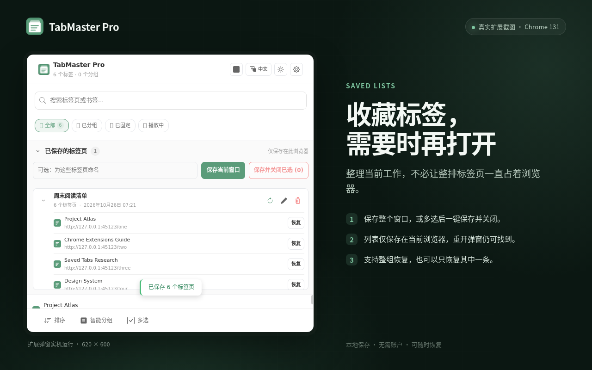

# TabMaster Pro

[中文](./README.md) | **English** | [Issues](https://github.com/icatw/TabMaster-Pro/issues)

TabMaster Pro is a Chrome extension built with Manifest V3, Vue 3, TypeScript, and Vite. It combines live tab search, sorting, grouping, and multi-select actions with persistent local tab collections that survive browser restarts.



## How It Compares with OneTab

OneTab's central workflow is to collect many tabs with little effort and restore them later. TabMaster Pro now supports that workflow end to end: save the current window, or save and close selected tabs. Saved data remains in `chrome.storage.local` and can be restored after a browser restart.

TabMaster Pro also keeps its live-window tools for search, sorting, grouping, and multi-select operations. Saved Lists are local to the current browser; cloud sync, cross-device sync, and public sharing are not included.

## Features

### Saved Lists

- Save the current window as a named list without closing its tabs.
- Select tabs, then save and close them in one action.
- Restore a whole list or one saved link.
- Rename or permanently delete lists; deletion uses a native confirmation dialog.
- Keep lists after restoring items so they can be reused.
- Deduplicate URLs within a list and migrate older storage data to a versioned format.
- Show local list and tab totals plus the oldest list date; review lists by creation age and explicitly select what to delete. Cleanup never runs automatically.
- Avoid closing tabs when saving fails; report actual partial success counts for restore and close operations.
- Save restorable URLs before single-tab close, batch close, keyboard `Delete`, and group close.

Saved Lists are stored only in the current browser's `chrome.storage.local`. They are not uploaded to a server.

### Tab Workflows

- Search open tabs and bookmarks together with match highlighting.
- Sort by domain, title, URL, last access time, or tab index.
- Group by domain while preserving pinned tabs and tabs that already belong to a group.
- Select multiple tabs for batch close or batch grouping.
- Collapse and rename tab groups.
- Navigate with arrow keys, `Enter`, `Delete`, `Escape`, and `Ctrl/Cmd+A`.

### Interface and Settings

- Chinese and English interfaces.
- Auto, light, and dark theme modes; Auto follows system theme changes.
- Settings stored in the current browser.
- Keyboard focus, accessible names, and native dialog semantics across the popup and options page.

## Install and Develop

### Requirements

| Tool | Requirement |
|---|---|
| Node.js | 18 or later; Node 20 LTS recommended |
| npm | 8 or later |
| Chrome / Chromium | 100 or later |

### Local Development

```bash
git clone https://github.com/icatw/TabMaster-Pro.git
cd TabMaster-Pro
npm ci
npm run dev
```

Keep the development server running, then:

1. Open `chrome://extensions/`.
2. Enable **Developer mode**.
3. Click **Load unpacked**.
4. Select the project's `dist` directory.

### Production Build

```bash
npm run build
```

Load the generated `dist` directory as an unpacked extension. To create a ZIP package:

```bash
npm run build:zip
```

### Validation

```bash
npm run type-check
npm run lint:check
npm test -- --run
npm run build
```

## Shortcuts

The manifest suggests the shortcuts below. Open `chrome://extensions/shortcuts` to see or change the active bindings.

| Action | Windows / Linux | macOS |
|---|---|---|
| Open TabMaster Pro | `Ctrl+Shift+Y` | `Command+Shift+Y` |
| Sort the current window | `Ctrl+Shift+S` | `Command+Shift+S` |
| Group tabs by domain | `Ctrl+Shift+X` | `Command+Shift+X` |
| Ungroup all tabs | `Ctrl+Shift+U` | `Command+Shift+U` |

Chrome or the operating system may reserve some combinations, so use the binding shown on the shortcuts page.

## Permissions

| Permission | Purpose |
|---|---|
| `tabs` | Read tabs in the current window, switch or close tabs, create restored tabs, and capture visible-tab thumbnails. |
| `tabGroups` | Create, read, and remove tab groups. |
| `storage` | Save settings and Saved Lists locally in the browser. |
| `bookmarks` | Search bookmarks that already exist in the browser. |
| `<all_urls>` | Allow Chrome's `captureVisibleTab` to capture the visible tab for thumbnails; the extension does not read or modify page content. |

## Project Structure

```text
src/
├── background/              # Manifest V3 service worker and message handlers
├── composables/             # Tab, search, keyboard, and theme logic
├── locales/                 # Chinese and English messages
├── options/                 # Options page
├── popup/                   # Extension popup
└── shared/
    ├── services/            # Tab, Saved Lists, and thumbnail services
    ├── types/               # Shared TypeScript types
    └── utils/               # Sorting, grouping, storage, and migration
```

Extension pages call the service worker through `chrome.runtime.sendMessage`; shared business logic lives in `src/shared`. Vitest uses a separate `vitest.config.ts` so development build plugins do not keep the test process alive.

## Known Limitations

- Saved Lists stay in the current browser and do not sync across devices.
- AI grouping, accounts, team collaboration, and configuration import/export are not included.
- Chrome prevents extensions from reopening protected pages such as `chrome://` pages and the Chrome Web Store.
- Automatic grouping uses domain rules only; it does not analyze page content.

## Contributing

Use [GitHub Issues](https://github.com/icatw/TabMaster-Pro/issues) for bug reports and feature requests. Run the commands in **Validation** before submitting a change.

## License

[MIT](./LICENSE)
